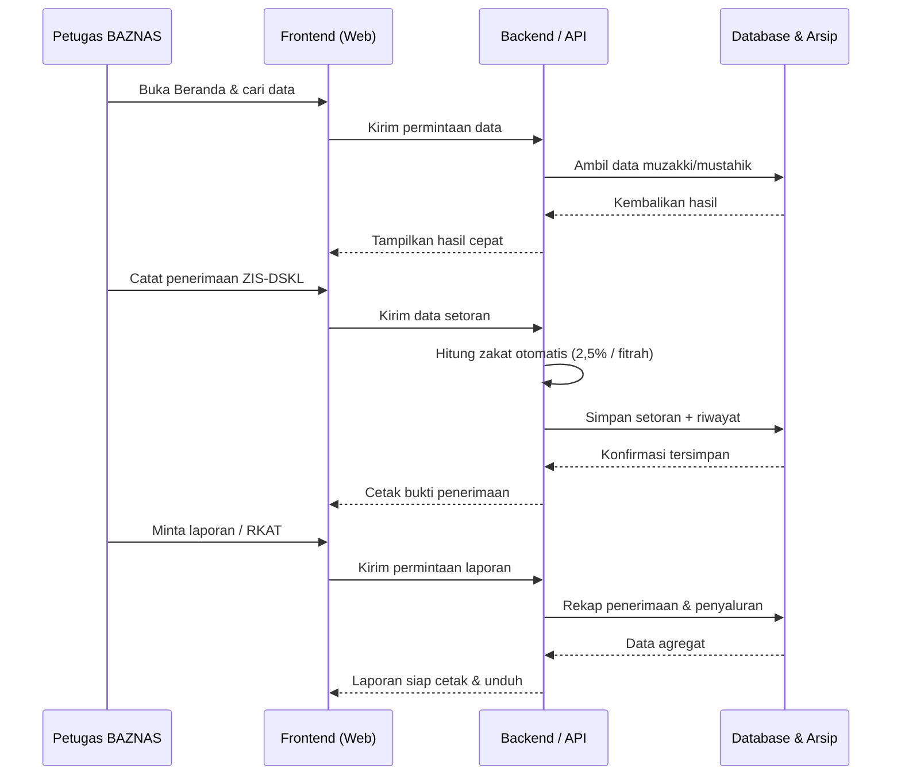
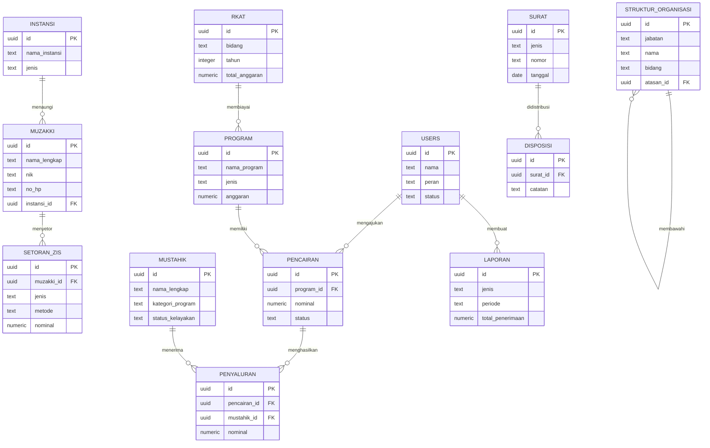

# PRD — Project Requirements Document

## 1. Overview

BAZNAS (Badan Amil Zakat Nasional) saat ini mengelola data zakat, infaq, sedekah, dan DSKL secara manual menggunakan Excel, catatan, atau penyimpanan file yang tersebar. Akibatnya, pencarian data memakan waktu, risiko duplikasi dan kehilangan arsip tinggi, serta penyusunan laporan keuangan sering lambat dan rawan salah hitung.

Aplikasi **Sistem Pengelolaan dan Arsip Data BAZNAS** hadir sebagai satu tempat terpusat untuk seluruh kegiatan Bidang I (Pengumpulan), Bidang II (Pendistribusian & Pendayagunaan), Bidang III (Keuangan), dan Bidang IV (Administrasi, SDM, & Umum). Tujuannya:

- **Mempercepat pencarian data** muzakki dan mustahik tanpa membuka Excel.
- **Menyatukan semua data** dalam satu sistem agar arsip aman dan rapi.
- **Menghasilkan laporan dan cetakan** (bukti terima, laporan keuangan, LPJ) secara otomatis dalam satu klik.
- **Mendukung pengambilan keputusan** pengurus melalui ringkasan angka zakat yang masuk dan tersalurkan.

Target utama kemenangan pertama: petugas dapat **mencetak laporan** dengan cepat dan benar.

---

## 2. Requirements

**Fungsional**
- Sistem mencatat pendaftaran muzakki (Nama Lengkap, NIK, No. HP/WA, Alamat) dan mengelompokkannya per OPD/instansi/organisasi.
- Sistem mencatat penerimaan ZIS-DSKL baik **tunai** maupun **transfer** melalui Sulutgo, Muamalat, dan BTN.
- Sistem menghitung **Zakat Profesi (2,5%)** dan **Zakat Fitrah** secara otomatis.
- Sistem mencatat DSKL sesuai jenis yang tersedia di BAZNAS (saat ini: Qurban).
- Sistem mencatat mustahik beserta kategori program (pendidikan, kesehatan, dakwah, ekonomi) dan status kelayakan.
- Sistem mengelola program, permohonan pencairan, persetujuan, dan bukti penyaluran.
- Sistem menyusun RKAT, realisasi anggaran, laporan keuangan, dan LPJ.
- Sistem mengarsipkan surat masuk/keluar, disposisi, SOP, data pegawai, dan aset.
- Sistem menyediakan login dengan hak akses per bidang dan pengelolaan akun petugas.
- Setelah login, sistem menampilkan **Beranda** sebagai halaman pembuka lintas bidang (pintasan ke dashboard Bidang I–IV + ringkasan angka) sebelum petugas masuk ke dashboard bidangnya masing-masing.
- Sistem menampilkan **Profil BAZNAS** (tentang/visi-misi) dan **Struktur Organisasi** (jabatan, nama, bidang, atasan) yang dapat diperbarui oleh admin.

**Non-Fungsional**
- Antarmuka berbahasa Indonesia, sederhana, dan mudah dipakai petugas non-teknis.
- Tema warna: **hijau tua, kuning, putih**; font **Poppins/Inter, sans-serif**.
- Pencarian data harus terasa cepat (hitungan detik).
- Data keuangan dan arsip harus aman, dengan cadangan data berkala.
- Akses dibatasi sesuai peran (Bidang I, II, III, IV, dan Admin).

---

## 3. Core Features

Fitur di bawah ini disusun selaras dengan roadmap yang telah disetujui, dikelompokkan per fase.

### Fase 1 — Fondasi Data & Pencarian
- **Beranda & Pencarian**
  - Berperan sebagai **halaman pembuka internal setelah login**, ditampilkan sebelum petugas masuk ke dashboard bidangnya masing-masing.
  - Pintasan Bidang — satu klik menuju dashboard Bidang I (Pengumpulan), II (Pendistribusian & Pendayagunaan), III (Keuangan), dan IV (Administrasi, SDM, & Umum).
  - Ringkasan Data — total zakat, infaq, sedekah, dan DSKL yang masuk maupun tersalurkan.
  - Pencarian Cepat — menemukan muzakki/mustahik tanpa membuka Excel.
  - Pintasan Menu — satu klik menuju pencatatan, data, atau laporan.
  - Pengingat Tugas — notifikasi permohonan pencairan atau surat yang menunggu.
  - **Profil BAZNAS & Struktur Organisasi** — halaman tentang BAZNAS (sejarah, visi-misi, tugas) dan bagan struktur organisasi (pimpinan, Bidang I–IV, amil) berupa tampilan ringkas yang dapat diperbarui admin.
- **Data Muzakki**
  - Pendaftaran Muzakki — nama lengkap, NIK, No. HP/WA, alamat.
  - Data per Instansi — pengelompokan berdasarkan OPD/instansi/organisasi.
  - Perbarui & Arsip — perbarui data lama, arsipkan data tidak aktif.
  - Riwayat Setoran — riwayat zakat yang pernah dibayarkan muzakki.
- **Penerimaan ZIS-DSKL**
  - Catat Tunai & Transfer — tunai atau transfer via Sulutgo, Muamalat, BTN.
  - Hitung Zakat Otomatis — Zakat Profesi 2,5% & Zakat Fitrah.
  - Bukti Penerimaan — buat & cetak tanda terima setoran.
  - Jenis DSKL — catat DSKL seperti qurban.

### Fase 2 — Mustahik & Penyaluran
- **Data Mustahik**
  - Pendaftaran Mustahik — identitas & kondisi calon penerima manfaat.
  - Kategori Program — pendidikan, kesehatan, dakwah, ekonomi.
  - Riwayat Bantuan — bantuan yang pernah diterima mustahik.
  - Status Kelayakan — aktif, lulus, atau perlu ditinjau ulang.
- **Program & Penyaluran**
  - Deskripsi Program — tujuan, sasaran, dan anggaran program.
  - Permohonan Pencairan — pengajuan & pemantauan pencairan dana.
  - Persetujuan Pencairan — setujui/tolak sesuai kewenangan.
  - Bukti Penyaluran — simpan bukti penyerahan bantuan.

### Fase 3 — Laporan & RKAT
- **Laporan & RKAT**
  - Laporan Keuangan — laporan penerimaan & penyaluran otomatis.
  - Cetak & Unduh — laporan siap tanda tangan.
  - Susun RKAT — rencana kerja & anggaran per bidang per tahun.
  - Realisasi Anggaran — bandingkan anggaran vs realisasi.
  - Laporan Pertanggungjawaban — LPJ program.

### Fase 4 — Administrasi & Aset
- **Administrasi & Aset**
  - Surat Masuk & Keluar — catat & arsipkan surat.
  - Disposisi Surat — teruskan surat + catatan arahan.
  - SOP — simpan standar prosedur kerja.
  - Kepegawaian — data pegawai, jabatan, riwayat.
  - Pengelolaan Aset — catat aset, kondisi, dan lokasi.

### Fase 5 — Pengaturan & Akun
- **Pengaturan & Akun**
  - Login & Peran — hak akses sesuai bidang tugas.
  - Kelola Pengguna — tambah/nonaktifkan akun petugas.
  - Tampilan & Tema — hijau tua, kuning, putih & font sistem.
  - Cadangan Data — salinan data berkala.

---

## 4. User Flow

**A0. Masuk & Beranda (Lintas Bidang)**
1. Pengguna **login** dengan hak akses peran (lihat flow E).
2. Sistem menampilkan **Beranda** sebagai halaman pembuka: ringkasan angka, pengingat tugas, dan **pintasan Bidang I–IV**.
3. Dari Beranda, petugas dapat membuka **Profil BAZNAS & Struktur Organisasi** atau langsung masuk ke dashboard bidangnya.
4. Petugas memilih bidang → masuk ke dashboard bidang terkait (flow A–D).

**A. Pendaftaran & Setoran Zakat (Bidang I)**
1. Petugas membuka **Beranda**.
2. Masuk ke menu **Data Muzakki** → **Pendaftaran Muzakki**.
3. Mengisi nama lengkap, NIK, No. HP/WA, dan alamat → simpan.
4. Muzakki/instansi menyetor zakat (tunai/transfer Sulutgo, Muamalat, BTN).
5. Petugas membuka **Penerimaan ZIS-DSKL** → pilih jenis (Zakat Profesi/Fitrah/Infaq/DSKL).
6. Sistem menghitung otomatis (contoh: Zakat Profesi 2,5%).
7. Petugas menyimpan dan **mencetak bukti penerimaan** untuk muzakki.
8. Data muzakki tersimpan & siap diarsipkan sesuai instansi.

**B. Penyaluran ke Mustahik (Bidang II)**
1. Petugas membuka **Data Mustahik** → **Pendaftaran Mustahik**.
2. Mengisi identitas, kondisi, dan kategori program (pendidikan/kesehatan/dakwah/ekonomi).
3. Menandai **status kelayakan**.
4. Petugas masuk ke **Program & Penyaluran** → buat **permohonan pencairan**.
5. Pejabat berwenang **menyetujui/menolak** permohonan.
6. Bukti penyaluran diunggah & tercatat sebagai riwayat bantuan mustahik.

**C. Laporan & RKAT (Bidang III)**
1. Petugas membuka **Laporan & RKAT**.
2. Sistem menyusun **laporan keuangan** otomatis dari data penerimaan & penyaluran.
3. Petugas memeriksa **realisasi anggaran** terhadap RKAT.
4. Membuat **LPJ** per program.
5. **Cetak/unduh** laporan siap tanda tangan.

**D. Administrasi, SDM & Umum (Bidang IV)**
1. Petugas mencatat **surat masuk/keluar**.
2. Membuat **disposisi** dengan catatan arahan ke petugas berwenang.
3. Menyimpan **SOP**, data **kepegawaian**, dan **aset** kantor.

**E. Pengaturan & Akun**
1. Pengguna **login** dengan hak akses peran.
2. Admin mengelola akun petugas dan **cadangan data**.
3. Semua pengguna dapat melihat tema hijau tua, kuning, putih dengan font Poppins/Inter.

---

## 5. Architecture

Sistem dibangun sebagai **aplikasi web terpusat** dengan arsitektur tiga lapis:

- **Lapisan Tampilan (Frontend)** — antarmuka berbasis browser yang dipakai petugas BAZNAS di setiap bidang.
- **Lapisan Logika (Backend/API)** — menangani autentikasi & hak akses, validasi data, perhitungan zakat otomatis, dan penyusunan laporan.
- **Lapisan Data (Database)** — menyimpan seluruh data muzakki, mustahik, ZIS-DSKL, program, keuangan, surat, pegawai, dan aset. Dilengkapi **cadangan data** berkala.

Diagram alur arsitektur:

Alur utama: petugas berinteraksi dengan antarmuka web → logika backend memproses (termasuk perhitungan zakat & rekap laporan) → data disimpan/diambil dari database terpusat.

---

## 6. Database Schema

Berikut tabel utama beserta field penting dan tipe datanya.

**users** — akun petugas BAZNAS
- id (UUID, PK)
- nama (TEXT)
- email (TEXT, unik)
- password_hash (TEXT)
- peran (TEXT: admin I/II/III/IV)
- status (TEXT: aktif/nonaktif)
- dibuat_pada (TIMESTAMP)

**instansi** — OPD/instansi/organisasi
- id (UUID, PK)
- nama_instansi (TEXT)
- jenis (TEXT: OPD/instansi/organisasi)
- alamat (TEXT)

**muzakki** — pemberi zakat
- id (UUID, PK)
- nama_lengkap (TEXT)
- nik (TEXT, unik)
- no_hp (TEXT)
- alamat (TEXT)
- instansi_id (UUID, FK → instansi.id)
- status (TEXT: aktif/arsip)
- dibuat_pada (TIMESTAMP)

**setoran_zis** — penerimaan zakat/infaq/sedekah/DSKL
- id (UUID, PK)
- muzakki_id (UUID, FK → muzakki.id)
- jenis (TEXT: zakat_profesi/zakat_fitrah/infaq/sedekah/dskl)
- metode (TEXT: tunai/transfer)
- bank (TEXT: Sulutgo/Muamalat/BTN)
- nominal (NUMERIC)
- persen (NUMERIC: mis. 2,5)
- bukti_no (TEXT, nomor tanda terima)
- tanggal (DATE)
- dibuat_pada (TIMESTAMP)

**mustahik** — penerima manfaat
- id (UUID, PK)
- nama_lengkap (TEXT)
- nik (TEXT)
- alamat (TEXT)
- kondisi (TEXT)
- kategori_program (TEXT: pendidikan/kesehatan/dakwah/ekonomi)
- status_kelayakan (TEXT: aktif/lulus/ditinjau)

**program** — program pendistribusian & pendayagunaan
- id (UUID, PK)
- nama_program (TEXT)
- deskripsi (TEXT)
- jenis (TEXT: pendistribusian/pendayagunaan)
- anggaran (NUMERIC)
- tahun (INTEGER)
- rkat_id (UUID, FK → rkat.id)

**pencairan** — permohonan & persetujuan pencairan
- id (UUID, PK)
- program_id (UUID, FK → program.id)
- nominal (NUMERIC)
- pemohon_id (UUID, FK → users.id)
- status (TEXT: diajukan/disetujui/ditolak)
- approver_id (UUID, FK → users.id)
- tanggal (DATE)

**penyaluran** — bukti penyerahan bantuan
- id (UUID, PK)
- pencairan_id (UUID, FK → pencairan.id)
- mustahik_id (UUID, FK → mustahik.id)
- nominal (NUMERIC)
- bukti_file (TEXT)
- tanggal (DATE)

**rkat** — rencana kerja & anggaran tahunan
- id (UUID, PK)
- bidang (TEXT)
- tahun (INTEGER)
- total_anggaran (NUMERIC)
- keterangan (TEXT)

**laporan** — laporan keuangan & LPJ
- id (UUID, PK)
- jenis (TEXT: keuangan/LPJ)
- periode (TEXT)
- total_penerimaan (NUMERIC)
- total_penyaluran (NUMERIC)
- dibuat_oleh (UUID, FK → users.id)
- dibuat_pada (TIMESTAMP)

**surat** — surat masuk/keluar
- id (UUID, PK)
- jenis (TEXT: masuk/keluar)
- nomor (TEXT)
- perihal (TEXT)
- tanggal (DATE)
- file (TEXT)

**disposisi** — arahan surat
- id (UUID, PK)
- surat_id (UUID, FK → surat.id)
- tujuan (UUID, FK → users.id)
- catatan (TEXT)
- status (TEXT)

**sop**
- id (UUID, PK)
- judul (TEXT)
- deskripsi (TEXT)
- file (TEXT)

**pegawai** — data kepegawaian
- id (UUID, PK)
- nama (TEXT)
- jabatan (TEXT)
- bidang (TEXT)
- status (TEXT: aktif/nonaktif)

**struktur_organisasi** — profil & bagan struktur organisasi (relasional sederhana)
- id (UUID, PK)
- jabatan (TEXT)
- nama (TEXT)
- bidang (TEXT: pimpinan/bidang_i/bidang_ii/bidang_iii/bidang_iv/amil)
- atasan_id (UUID, FK → struktur_organisasi.id, nullable)
- urutan (INTEGER, urutan tampil pada bagan)
- keterangan (TEXT, nullable)

**profil_baznas** — konten profil BAZNAS
- id (UUID, PK)
- tentang (TEXT)
- visi (TEXT)
- misi (TEXT)
- diperbarui_oleh (UUID, FK → users.id)
- diperbarui_pada (TIMESTAMP)

**aset** — pengelolaan aset kantor
- id (UUID, PK)
- nama_aset (TEXT)
- kondisi (TEXT)
- lokasi (TEXT)
- tanggal_perolehan (DATE)

Diagram ER:

---

## 7. Tech Stack

Sesuai pilihan "AI yang menentukan", berikut rekomendasi yang paling sesuai untuk aplikasi web internal BAZNAS yang fokus pada pencarian cepat, pencatatan, dan cetak laporan:

- **Frontend:** Next.js + Tailwind CSS + shadcn/ui — tampilan modern, cepat, dan konsisten. Tema diatur hijau tua, kuning, putih dengan font **Poppins/Inter (sans-serif)**.
- **Backend:** Next.js API Routes / Server Actions — satu basis kode untuk tampilan dan logika, cukup ringan untuk tim kecil.
- **Database:** SQLite dengan Drizzle ORM — sederhana, cepat, dan cocok untuk volume data BAZNAS. Bila volume dan jumlah pengguna meningkat besar, dapat ditingkatkan ke PostgreSQL tanpa mengubah struktur kode secara berarti.
- **Autentikasi & Hak Akses:** Better Auth — mendukung peran petugas per bidang (Admin I–IV).
- **Deployment:** Vercel atau server lokal kantor (dengan fasilitas cadangan data berkala).
- **Cetak Laporan:** Kemampuan cetak/unduh bawaan (PDF) dari browser untuk bukti penerimaan, laporan keuangan, dan LPJ.

Catatan: tidak ada kebutuhan AI pada sistem ini, sehingga InsForge Model Gateway atau provider AI lain tidak digunakan. Seluruh fokus diarahkan pada kecepatan pencarian, kerapian arsip, dan kemudahan cetak laporan.